# 03. ER-диаграмма PsyWeb

**Проект:** PsyWeb  
**Архитектура:** Spring Boot Modular Monolith  
**СУБД:** PostgreSQL  
**Статус:** DRAFT — целевая схема данных

---

# 1. Назначение

Документ определяет логическую структуру данных PsyWeb:

- сущности и таблицы;
- первичные и внешние ключи;
- кардинальности;
- ограничения уникальности;
- правила ссылочной целостности;
- важные межтабличные инварианты;
- ограничения конкурентного доступа.

ER-диаграмма описывает целевую архитектуру после переработки существующего backend.

Она не является готовым исполняемым PostgreSQL DDL.

## 1.1. Принятые решения

В целевой модели утверждены:

1. Динамический расчёт доступного времени без заранее созданных AvailabilitySlot.
2. Разделение ServiceOffering, Working Schedule и ScheduleOccupancy.
3. Два режима расписания: REGULAR и FLOATING.
4. Версионирование полного недельного графика.
5. Единая модель DateSchedule для ручного графика и исключений.
6. Отсутствие рабочих окон, пересекающих полночь.
7. Хранение только действующих ScheduleOccupancy.
8. Сохранение истории Reservation и Booking.
9. Фиксация условий услуги при создании Reservation.
10. Один редактируемый отзыв клиента на специалиста.
11. Обязательное подтверждение успешной консультации перед созданием отзыва.

---

# 2. Обозначения

В диаграммах Mermaid:

- `||` — ровно одна запись;
- `o|` — ноль или одна;
- `o{` — ноль или несколько.

Обозначения ограничений:

- PK — Primary Key;
- FK — Foreign Key;
- UQ — UNIQUE;
- NN — NOT NULL;
- CHECK — проверочное ограничение.

Кардинальности описывают логические связи.

Некоторые бизнес-инварианты невозможно обеспечить одним внешним ключом. Такие требования отдельно фиксируются для сервисного слоя и PostgreSQL.

---

# 3. Общая ER-диаграмма

Диаграмма показывает основные сущности целевого ядра.

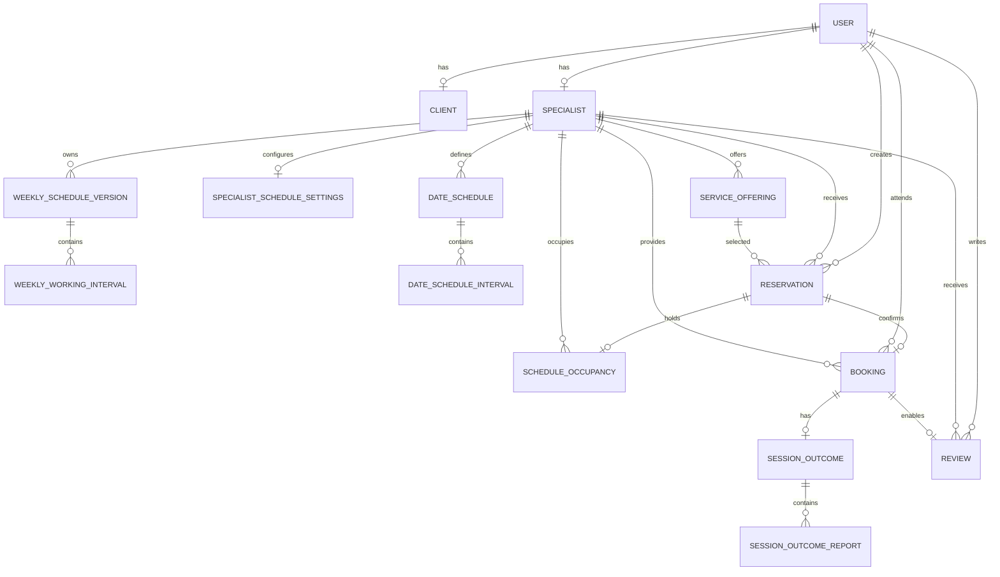

Данная диаграмма не означает, что Availability является отдельной таблицей.

Availability вычисляется на основании существующего рабочего графика, условий услуги и действующих занятых интервалов.

---

# 4. User, Client и Specialist

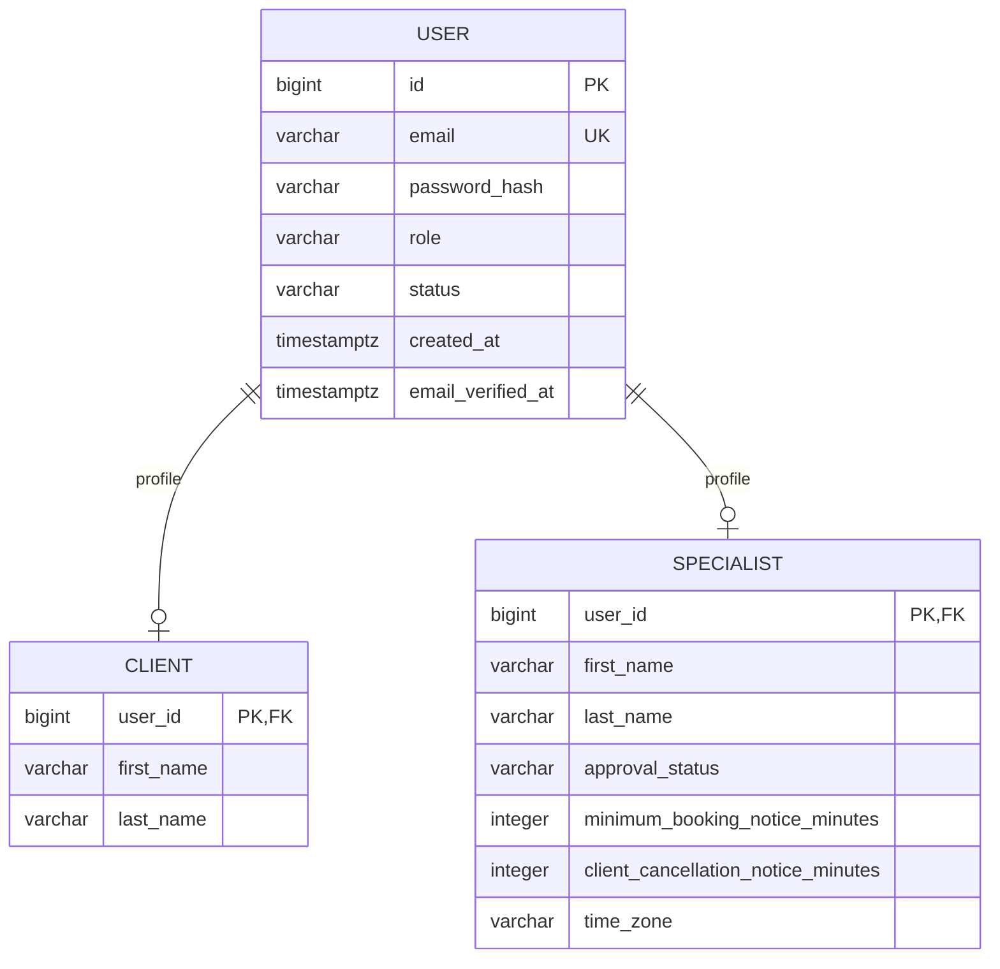

## 4.1. User

Основные ограничения:

- `users.id` — PK;
- `users.email` — UNIQUE, NOT NULL;
- `role` — обязательное перечисление;
- `status` — обязательное перечисление;
- `created_at` — NOT NULL.

Пароль хранится только в виде хеша.

## 4.2. Client

`clients.user_id` одновременно:

- первичный ключ;
- внешний ключ на `users.id`.

Дополнительный независимый идентификатор Client не требуется.

Создание Client разрешено только для User с соответствующей ролью.

## 4.3. Specialist

`specialists.user_id` одновременно:

- первичный ключ;
- внешний ключ на `users.id`.

Основные ограничения:

- `minimum_booking_notice_minutes >= 0`;
- `client_cancellation_notice_minutes >= 0`;
- `time_zone` соответствует допустимому ZoneId.

Проверка роли SPECIALIST и профессиональной доступности выполняется согласно доменным правилам.

## 4.4. Кардинальности

- User → Client: 1:0..1.
- User → Specialist: 1:0..1.

Один User не должен одновременно иметь несовместимые профили CLIENT и SPECIALIST при действующей модели единственной роли.

Это межтабличный инвариант.

---

# 5. ServiceOffering

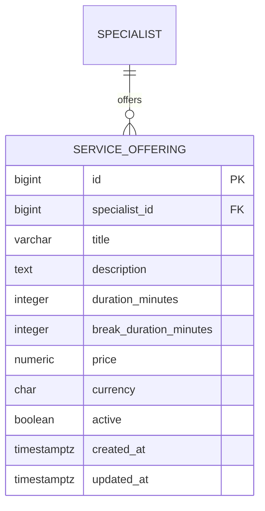

## 5.1. Поля

| Поле | PostgreSQL | Обязательность |
|---|---|---|
| id | BIGINT | PK |
| specialist_id | BIGINT | FK, NN |
| title | VARCHAR | NN |
| description | TEXT | NULL |
| duration_minutes | INTEGER | NN |
| break_duration_minutes | INTEGER | NN |
| price | NUMERIC | NN |
| currency | CHAR(3) | NN |
| active | BOOLEAN | NN |
| created_at | TIMESTAMPTZ | NN |
| updated_at | TIMESTAMPTZ | NN |

## 5.2. Ограничения

- `duration_minutes > 0`;
- `break_duration_minutes >= 0`;
- `price >= 0`;
- услуга принадлежит одному специалисту;
- неактивная услуга не используется для новых резервирований.

Окончательные пределы длительности и валютная политика утверждаются отдельно.

## 5.3. Исторические условия

Редактирование ServiceOffering не изменяет существующие Reservation и Booking.

Исторические условия сохраняются отдельно в snapshot Reservation.

Ссылки исторических записей на ServiceOffering не должны становиться недействительными из-за её деактивации.

---

# 6. SpecialistScheduleSettings

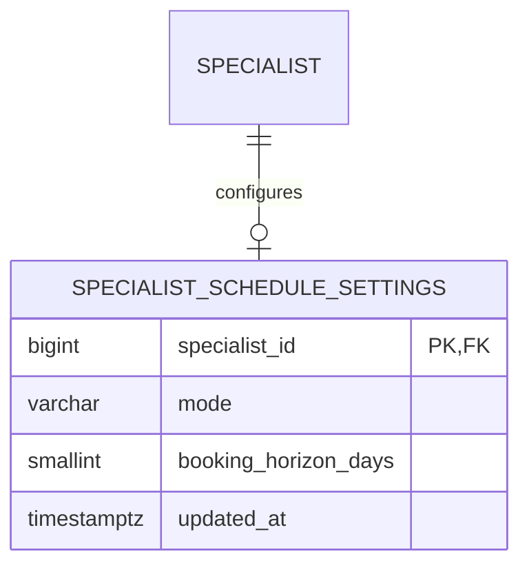

## 6.1. Назначение

Настройки текущего режима работы расписания специалиста.

## 6.2. ScheduleMode

- REGULAR;
- FLOATING.

## 6.3. Ограничения

- `specialist_id` — PK и FK;
- `mode` — NOT NULL;
- `booking_horizon_days` — NOT NULL;
- допустимые значения горизонта: 14, 30, 60, 90;
- значение по умолчанию: 30.

В ходе реализации необходимо определить, создаются ли настройки одновременно с Specialist или при первом обращении к управлению расписанием.

## 6.4. Переключение режимов

При смене режима ранее сохранённые правила другого режима могут оставаться в базе.

Однако для вычисления доступности применяется только активный режим.

Изменение режима не отменяет существующие Booking автоматически.

---

# 7. WeeklyScheduleVersion

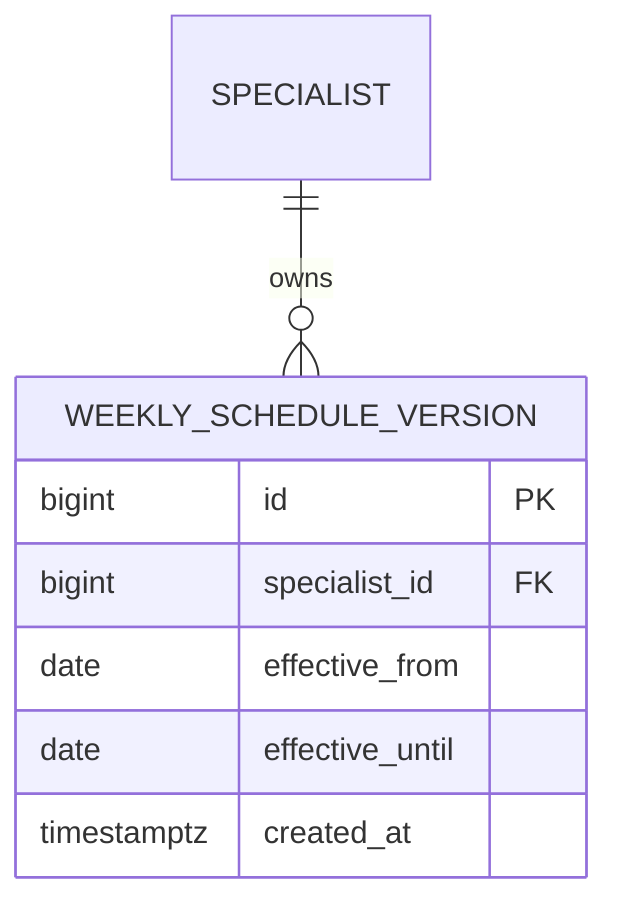

## 7.1. Назначение

Представляет полную версию постоянного недельного графика.

Каждая версия определяет рабочее расписание специалиста на заданный календарный период.

## 7.2. Поля

| Поле | PostgreSQL | Обязательность |
|---|---|---|
| id | BIGINT | PK |
| specialist_id | BIGINT | FK, NN |
| effective_from | DATE | NN |
| effective_until | DATE | NULL |
| created_at | TIMESTAMPTZ | NN |

## 7.3. Правила периодов

Принимается следующее представление:

- `effective_from` — включительно;
- `effective_until` — включительно;
- NULL для `effective_until` означает отсутствие конечной даты.

Если последняя дата старой версии — 31 октября, новая версия может начинаться 1 ноября.

## 7.4. Основные ограничения

1. Версия принадлежит одному специалисту.
2. Версии одного специалиста не имеют пересекающихся периодов действия.
3. `effective_until >= effective_from`, если дата окончания задана.
4. На любую календарную дату действует не более одной недельной версии.
5. Внутри версии хранится полный недельный шаблон.

## 7.5. Версионирование

При изменении постоянного графика с будущей даты формируется новая версия.

Предыдущий период корректно завершается.

Операция должна быть атомарной.

Если существуют уже запланированные будущие версии, изменение не должно незаметно уничтожать или перезаписывать их.

## 7.6. Защита PostgreSQL

Для запрета пересечения периодов возможно использование GiST exclusion constraint по специалисту и диапазону дат.

Окончательный SQL фиксируется в Relational Schema.

---

# 8. WeeklyWorkingInterval

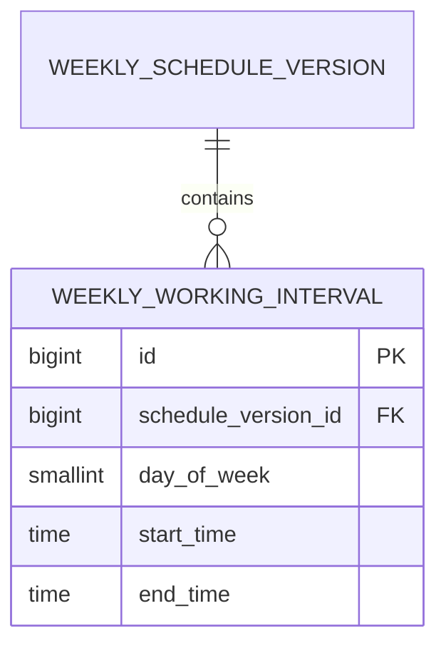

## 8.1. Назначение

Хранит рабочий интервал конкретного дня недели внутри одной версии графика.

## 8.2. Ограничения

- `schedule_version_id` — FK, NN;
- `day_of_week` находится в диапазоне 1–7;
- `start_time < end_time`;
- интервал не пересекает полночь;
- интервалы одного дня одной версии не пересекаются.

Для одного дня можно хранить несколько непересекающихся интервалов.

Например:

- понедельник 10:00–12:00;
- понедельник 14:00–18:00.

Они образуют два отдельных рабочих окна.

Консультация не может пересекать промежуток между ними.

## 8.3. Ограничение конца суток

Java LocalTime не представляет значение 24:00 как отдельное допустимое время суток.

Поэтому правило представления рабочего окна, заканчивающегося ровно в полночь, требует отдельного согласования.

Рабочие интервалы, пересекающие границу суток, запрещены.

---

# 9. DateSchedule

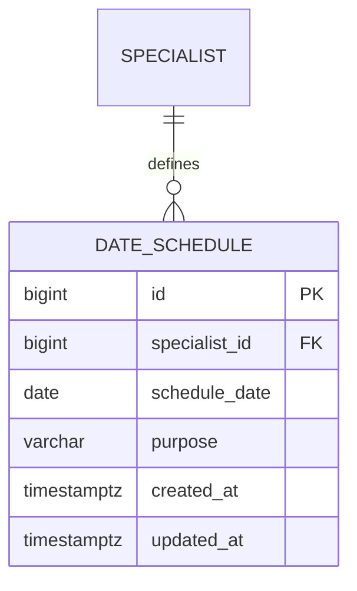

## 9.1. Назначение

Единая модель расписания конкретной даты.

Используется для:

- ручных рабочих дат плавающего графика;
- исключений регулярного графика.

## 9.2. DateSchedulePurpose

- MANUAL;
- OVERRIDE.

## 9.3. Уникальность

Обязательное ограничение:

`UNIQUE(specialist_id, schedule_date, purpose)`

Это означает, что для конкретной даты могут физически существовать MANUAL и OVERRIDE, но каждый из них представлен не более одной записью.

## 9.4. MANUAL

Применяется в режиме FLOATING.

Рабочие часы определяются дочерними DateScheduleInterval.

При отсутствии MANUAL дата нерабочая.

## 9.5. OVERRIDE

Применяется в режиме REGULAR.

OVERRIDE заменяет соответствующие часы WeeklyScheduleVersion.

Пустой набор интервалов означает выходной.

При отсутствии OVERRIDE действуют часы недельной версии.

## 9.6. Ограничения

- Изменение DateSchedule не отменяет существующие Booking автоматически.
- При смене режима нельзя случайно применять DateSchedule другого назначения.
- Сохранение и замена интервалов выполняются согласованно.
- Для одной даты должен существовать однозначный итоговый рабочий график.

---

# 10. DateScheduleInterval

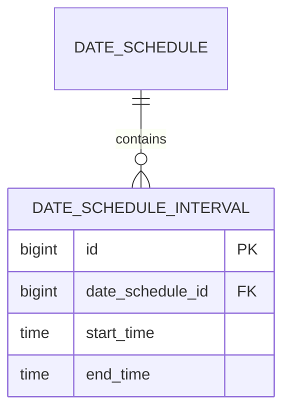

## 10.1. Ограничения

- `date_schedule_id` — FK, NN;
- `start_time < end_time`;
- рабочее окно не пересекает полночь;
- интервалы внутри одного DateSchedule не пересекаются.

Несколько непересекающихся интервалов допустимы.

## 10.2. Согласованность

Замена расписания даты должна выполняться как одна операция.

Не допускается промежуточное частично сохранённое состояние, при котором старые интервалы уже удалены, а новые сохранены только частично.

---

# 11. EffectiveWorkingWindow

EffectiveWorkingWindow не является таблицей.

Это вычисляемое представление непрерывного рабочего окна:

- start: Instant;
- end: Instant.

Окно вычисляется из:

- режима расписания;
- недельной версии или ручных интервалов;
- исключений конкретной даты;
- часового пояса специалиста.

Оно используется при расчёте Availability и создании Reservation.

EffectiveWorkingWindow не содержит статуса FREE, RESERVED или BOOKED.

---

# 12. Reservation, ScheduleOccupancy и Booking

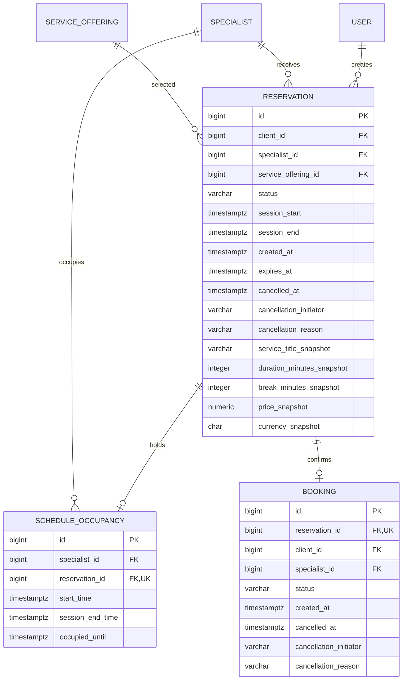

# 13. Reservation

## 13.1. Назначение

Временное удержание конкретного времени и согласованных условий услуги.

## 13.2. Состояния

- ACTIVE;
- CONFIRMED;
- CANCELLED;
- EXPIRED.

## 13.3. Основные переходы

- ACTIVE → CONFIRMED;
- ACTIVE → CANCELLED;
- ACTIVE → EXPIRED.

После подтверждения создаётся Booking.

## 13.4. Инварианты

1. Reservation принадлежит клиенту.
2. Указанная услуга принадлежит указанному специалисту.
3. Консультация помещается в одно непрерывное рабочее окно.
4. Соблюдается шаг начала 15 минут.
5. Соблюдается минимальный срок предварительной записи.
6. Соблюдается горизонт бронирования.
7. Условия услуги фиксируются при создании.
8. Создание Reservation и Occupancy атомарно.
9. Истёкшая Reservation не может быть подтверждена.

## 13.5. Snapshot

Reservation содержит исторические условия:

- название услуги;
- продолжительность;
- перерыв;
- цену;
- валюту.

После создания эти значения не изменяются вслед за ServiceOffering.

## 13.6. Ссылки

Историческая Reservation остаётся в базе независимо от удаления Occupancy.

Для подтверждённой Booking исходная Reservation сохраняется.

---

# 14. ScheduleOccupancy

## 14.1. Назначение

ScheduleOccupancy содержит только интервалы, которые в данный момент должны блокировать новые записи.

В таблице нет освобождённых строк.

## 14.2. Связи

Каждая Occupancy принадлежит:

- одному специалисту;
- одной исходной Reservation.

Для одной Reservation может существовать не более одной Occupancy.

Историческая Reservation может не иметь Occupancy после освобождения.

## 14.3. Временные интервалы

Консультация:

`[start_time, session_end_time)`

Занятость:

`[start_time, occupied_until)`

occupied_until включает обязательный перерыв.

## 14.4. Ограничения

- `reservation_id` — UNIQUE, NOT NULL;
- `start_time < session_end_time`;
- `session_end_time <= occupied_until`;
- у одного специалиста нет пересекающихся интервалов Occupancy.

## 14.5. Конкурентное ограничение

Концептуальный вариант PostgreSQL:

```sql
CREATE EXTENSION IF NOT EXISTS btree_gist;

ALTER TABLE schedule_occupancies
ADD CONSTRAINT no_overlapping_schedule_occupancies
EXCLUDE USING gist (
    specialist_id WITH =,
    tstzrange(start_time, occupied_until, '[)') WITH &&
);
```

Это ограничение защищает от двойного бронирования.

Оно не проверяет соответствие рабочего времени Schedule.

## 14.6. Освобождение

Occupancy удаляется при:

- отмене ACTIVE Reservation;
- истечении Reservation;
- допустимой отмене Booking.

Удаление выполняется в одной транзакции с соответствующим изменением бизнес-состояния.

Booking и Reservation не удаляются.

## 14.7. Открытое решение

Необходимо определить момент освобождения Occupancy после окончания консультации, если Booking не отменена.

Эта операция не должна сама по себе объявлять консультацию успешно состоявшейся.

---

# 15. Booking

## 15.1. Назначение

Подтверждённая запись на консультацию.

## 15.2. Кардинальность

`Reservation 1 → 0..1 Booking`

Обязательное ограничение:

`UNIQUE(bookings.reservation_id)`

Каждая Booking обязательно имеет исходную Reservation.

## 15.3. Инварианты

1. Booking создаётся после допустимого подтверждения Reservation.
2. Одна Reservation не может создать две Booking.
3. Подтверждение не освобождает Occupancy.
4. Отмена Booking освобождает Occupancy по установленным правилам.
5. Исторические условия консультации остаются неизменными.
6. Изменение ServiceOffering не меняет Booking.
7. История отменённой консультации сохраняется.

## 15.4. Статусы

Существующая модель использует:

- CONFIRMED;
- CANCELLED;
- COMPLETED;
- NO_SHOW.

Окончательная система состояний будет согласована с SessionOutcome.

Статус Booking не должен позволять одной стороне произвольно объявлять консультацию успешно состоявшейся.

## 15.5. Отмена

Фиксируются:

- cancelled_at;
- cancellation_initiator;
- cancellation_reason.

Поздняя клиентская отмена определяется по времени относительно правила clientCancellationNotice.

Отдельный статус LATE_CANCELLED не вводится.

---

# 16. SessionOutcome и SessionOutcomeReport

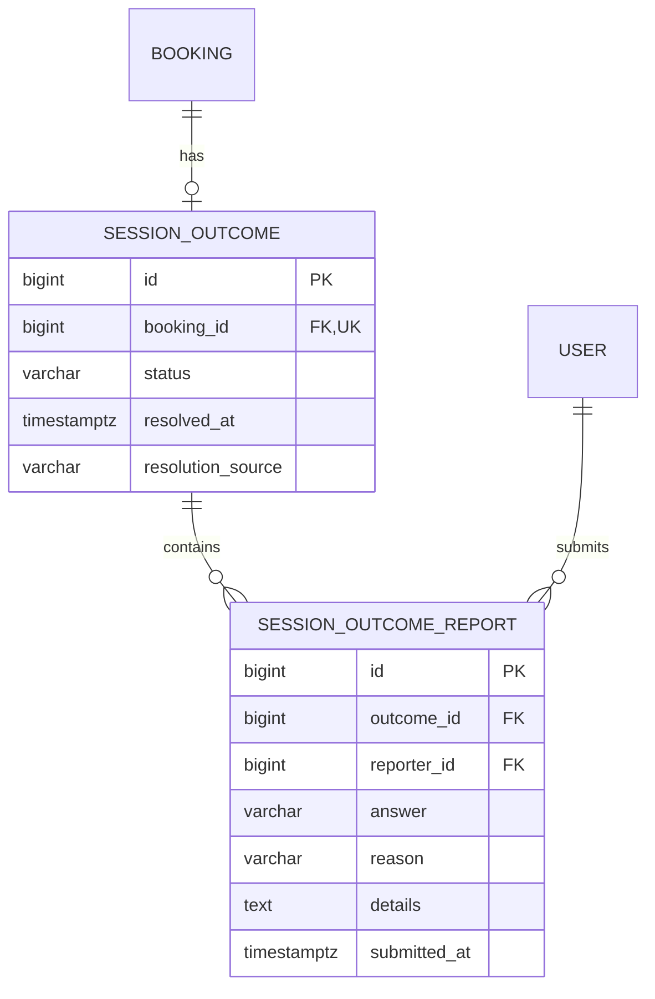

## 16.1. Назначение

SessionOutcome представляет итог консультации.

SessionOutcomeReport представляет независимый ответ одного участника.

## 16.2. Кардинальности

- Booking → SessionOutcome: 1:0..1.
- SessionOutcome → SessionOutcomeReport: 1:0..2 для MVP.
- User → SessionOutcomeReport: 1:N.

## 16.3. Основные правила

- Клиент и специалист отвечают независимо.
- Период ответа составляет 24 часа.
- Оба OCCURRED подтверждают успешную консультацию.
- Совместимые DID_NOT_OCCUR могут быть разрешены автоматически.
- Если одна сторона ответила, а другая нет, результат принимается после истечения периода согласно согласованной политике.
- Противоречащие ответы становятся спором.
- Если никто не ответил, успешный результат не предполагается.

## 16.4. Ограничения

- UNIQUE(session_outcomes.booking_id);
- UNIQUE(session_outcome_reports.outcome_id, reporter_id);
- reporter должен быть участником консультации;
- при DID_NOT_OCCUR требуется структурированная причина.

Проверка того, что reporter является участником консультации, требует бизнес-проверки либо специально спроектированного ограничения.

---

# 17. Review

**Утверждённое бизнес-правило: один редактируемый отзыв клиента на специалиста.**

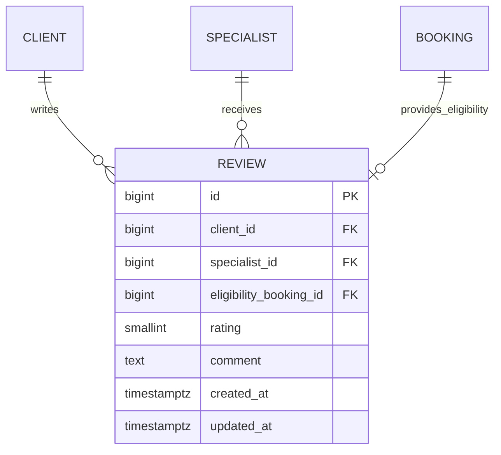

## 17.1. Назначение

Review представляет отзыв клиента о специалисте в целом.

Не является отдельной оценкой каждой консультации.

## 17.2. Кардинальности

- Client → Review: 1:N.
- Specialist → Review: 1:N.
- Booking → Review: 1:0..1.

Последняя связь указывает на консультацию, подтвердившую первоначальное право на отзыв.

## 17.3. Уникальность

Обязательное ограничение:

`UNIQUE(client_id, specialist_id)`

Один клиент не может создать несколько отзывов одному специалисту.

Количество успешно проведённых консультаций не отменяет ограничение.

## 17.4. Основание для отзыва

Review может быть создан только после успешно подтверждённой консультации.

eligibility_booking_id должен ссылаться на Booking:

- данного клиента;
- данного специалиста;
- с подтверждённым успешным SessionOutcome.

Статус Booking.CONFIRMED сам по себе недостаточен.

## 17.5. Рейтинг

Оценка обязательна:

`CHECK(rating BETWEEN 1 AND 5)`

Текстовый комментарий необязателен.

## 17.6. Редактирование

Автор может изменить:

- rating;
- comment.

При изменении обновляется updated_at.

Нельзя изменить:

- автора;
- специалиста;
- исходную eligibilityBooking;
- дату создания.

Редактирование не создаёт новую строку Review.

Психолог не может редактировать отзыв клиента.

## 17.7. Агрегированный рейтинг

Агрегированные оценки вычисляются из актуальных Review.

Кэш средней оценки допускается позднее, но не является обязательной частью MVP.

## 17.8. Открытые вопросы

- Удаление собственного отзыва.
- Административное скрытие.
- История редакций.
- Сроки редактирования.

---

# 18. Административные сущности

Первоначальная ER-модель содержала историю модерационных действий и административное разрешение споров.

Эти понятия сохраняются.

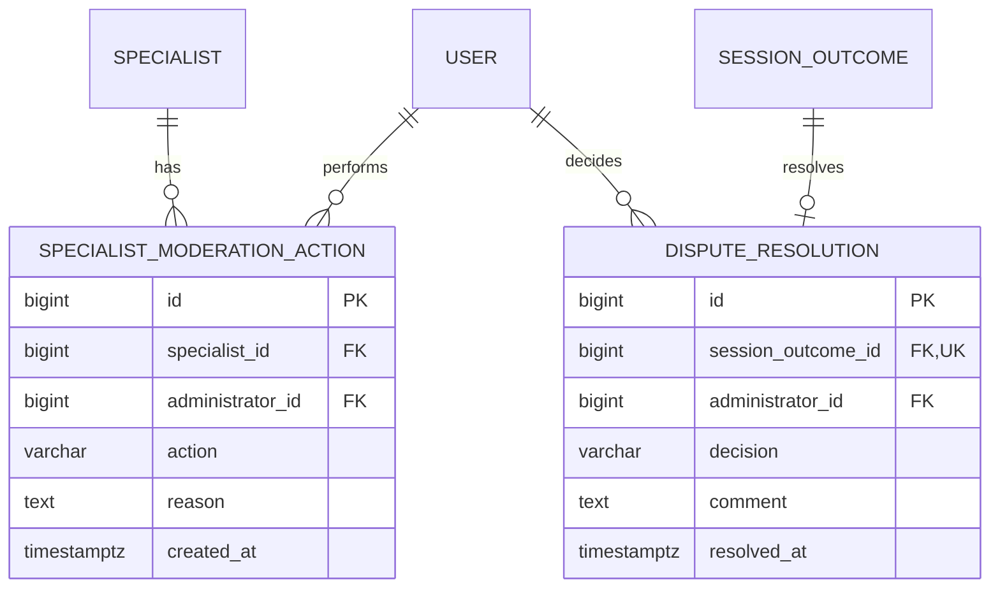

## 18.1. SpecialistModerationAction

Назначение:

- хранить историю решений модератора;
- фиксировать администратора;
- сохранять действие, причину и время.

История не удаляется при восстановлении или повторной блокировке специалиста.

## 18.2. DisputeResolution

Назначение:

- фиксировать итог административного рассмотрения спора;
- сохранять решение и обоснование;
- связывать решение с SessionOutcome.

Основная кардинальность:

SessionOutcome → DisputeResolution: 1:0..1.

Правила пересмотра решения ещё требуют согласования.

## 18.3. Ограничения

Административные операции должны проверять полномочия.

Роль ADMIN сама по себе не означает разрешения обходить бизнес-инварианты бронирования.

Необходимо согласовать, какие операции требуют отдельных неизменяемых записей аудита.

---

# 19. AuthenticationSession и Notification

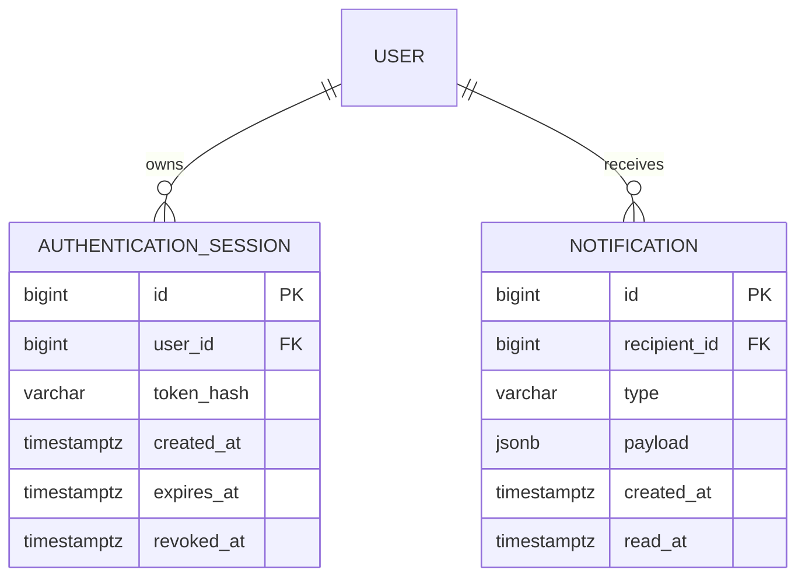

Эти сущности относятся к проектируемым возможностям.

## 19.1. AuthenticationSession

Хранит информацию о refresh-сессии.

Refresh token не сохраняется открытым значением.

Должны быть предусмотрены:

- срок действия;
- отзыв;
- политика повторного использования;
- будущая возможность rotation.

Конкретная security-модель определяется в Authentication Flow.

## 19.2. Notification

Представляет уведомление пользователя.

read_at показывает факт прочтения внутриплатформенного уведомления.

## 19.3. Доставка Notification

Состояние READ/UNREAD не следует смешивать со статусом доставки.

Для отслеживания отправки email/push может потребоваться отдельная NotificationDelivery.

Её наличие и структуру определим в Notification Domain Design.

---

# 20. ChatThread и Message

Функциональность чата сохраняется как возможное будущее расширение.

Она не является обязательной частью текущего booking redesign.

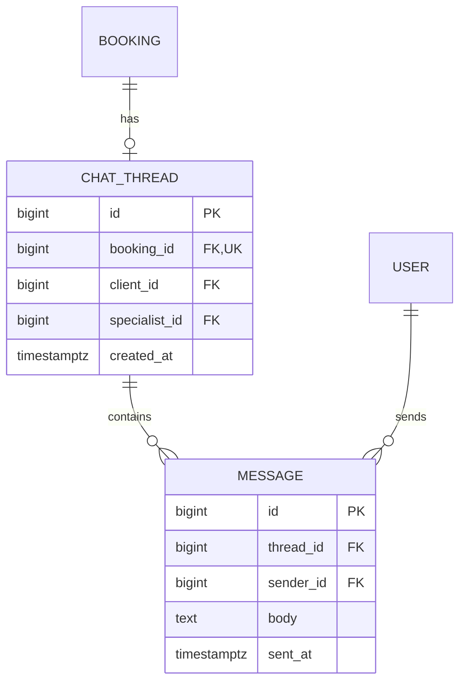

## 20.1. Кардинальности

- Booking → ChatThread: 1:0..1.
- ChatThread → Message: 1:N.
- User → Message: 1:N.

## 20.2. Ограничения

- Один ChatThread связан с одной Booking.
- Отправитель должен быть участником переписки.
- История сообщений не управляет состоянием Booking.
- Возможность отправки после завершения консультации определяется отдельно.
- Правила удаления и хранения переписки требуют самостоятельной спецификации.

---

# 21. Сводка ключевых ограничений

| Сущность | Ограничение |
|---|---|
| User | UNIQUE(email) |
| Client | PK/FK(user_id) |
| Specialist | PK/FK(user_id) |
| SpecialistScheduleSettings | PK/FK(specialist_id) |
| WeeklyScheduleVersion | Непересекающиеся периоды специалиста |
| WeeklyWorkingInterval | Непересекающиеся часы одного дня версии |
| DateSchedule | UNIQUE(specialist_id, schedule_date, purpose) |
| DateScheduleInterval | Непересекающиеся интервалы одного DateSchedule |
| ScheduleOccupancy | UNIQUE(reservation_id), запрет пересечения занятости |
| Booking | UNIQUE(reservation_id) |
| SessionOutcome | UNIQUE(booking_id) |
| SessionOutcomeReport | UNIQUE(outcome_id, reporter_id) |
| Review | UNIQUE(client_id, specialist_id) |
| Review | CHECK(rating BETWEEN 1 AND 5) |
| DisputeResolution | UNIQUE(session_outcome_id) |
| ChatThread | UNIQUE(booking_id) |

Приведённые ограничения дополняются NOT NULL, FK и CHECK в конкретном DDL.

---

# 22. Межтабличные бизнес-инварианты

Некоторые инварианты требуют проверок нескольких таблиц.

## 22.1. Reservation и ServiceOffering

Reservation.specialist_id должен соответствовать владельцу ServiceOffering.

## 22.2. Occupancy и Reservation

Occupancy.specialist_id должен соответствовать Reservation.specialist_id.

Время Occupancy должно соответствовать выбранной консультации и сохранённому перерыву.

## 22.3. Booking и Reservation

Booking.client_id и Booking.specialist_id должны соответствовать исходной Reservation.

## 22.4. Review и Booking

Review.client_id должен соответствовать клиенту eligibilityBooking.

Review.specialist_id должен соответствовать специалисту eligibilityBooking.

SessionOutcome выбранной Booking должен подтверждать успешное проведение консультации.

## 22.5. SessionOutcomeReport

Reporter является клиентом или специалистом соответствующей Booking.

## 22.6. Admin

Administrator должен иметь необходимые полномочия.

Нельзя считать любое значение administrator_id достаточным подтверждением авторизации.

Эти инварианты должны обеспечиваться согласованными бизнес-операциями.

При проектировании DDL рассматривается возможность усиления отдельных инвариантов составными внешними ключами.

---

# 23. Согласованность при изменении графика

Рабочее расписание и Occupancy принадлежат разным логическим областям, но участвуют в общем инварианте доступности.

Создание Reservation должно проверять:

- активный режим графика;
- действующую недельную версию либо ручную дату;
- применимое исключение;
- границы непрерывного рабочего окна;
- параметры выбранной услуги;
- существующую занятость;
- дедлайн записи;
- горизонт бронирования.

Одновременное изменение графика не должно позволять успешно создать Reservation на уже закрытое время.

PostgreSQL exclusion constraint на Occupancy не решает эту проблему самостоятельно.

Нужна дополнительная транзакционная координация.

Решение о конкретных узких блокировках принимается в Transaction and Concurrency Model.

Общую блокировку всех бронирований специалиста в качестве основного решения не используем.

---

# 24. Политика сохранения истории

Исторические записи сохраняются:

- Reservation;
- Booking;
- SessionOutcome;
- SessionOutcomeReport;
- Review;
- административные решения.

Действующая ScheduleOccupancy удаляется при освобождении времени.

Удаление Occupancy не должно приводить к каскадному удалению Reservation или Booking.

Старые версии недельного графика сохраняются в рамках выбранной политики версионирования.

Постоянная история всех вычисленных свободных начал не ведётся.

---

# 25. Открытые решения

До окончательного PostgreSQL DDL необходимо уточнить:

1. DST-политику.
2. Представление рабочих окон до конца суток.
3. Изменение часового пояса специалиста.
4. Изменение уже запланированных будущих WeeklyScheduleVersion.
5. Координацию массового изменения расписания с конкурентными Reservation.
6. Поведение ACTIVE Reservation при закрытии графика.
7. Освобождение Occupancy после окончания консультации.
8. Финальные BookingStatus и SessionOutcomeStatus.
9. Необходимость отдельных таблиц доставки уведомлений.
10. Окончательные правила редактирования и модерации отзывов.
11. Политику разрешения и пересмотра административных споров.

---

# 26. Итог

Целевая ER-модель PsyWeb включает:

- профили пользователей;
- каталог услуг;
- версионируемый недельный график;
- расписание отдельных дат;
- динамически рассчитываемую доступность;
- действующую занятость;
- временные Reservation;
- подтверждённые Booking;
- отчёты о проведении консультаций;
- редактируемые отзывы клиентов о специалистах;
- административную историю;
- уведомления и будущие возможности коммуникации.

Модель не использует AvailabilitySlot как основную единицу бронирования.

**Статус: DRAFT.**

Следующие этапы — согласование оставшихся инвариантов, транзакционной модели и PostgreSQL DDL.