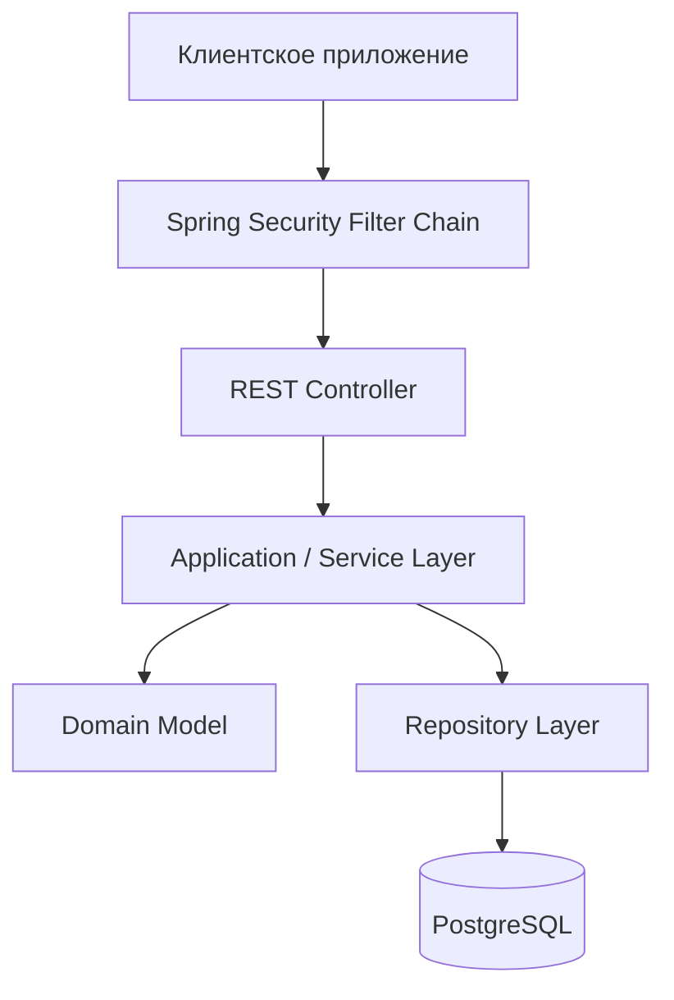

# 01. Обзор архитектуры backend PsyWeb

**Проект:** PsyWeb  
**Архитектура:** Spring Boot Modular Monolith  
**Язык:** Java 21  
**База данных:** PostgreSQL  
**Миграции:** Flyway  
**Статус:** DRAFT — целевая архитектура MVP

---

# 1. Назначение документа

Документ описывает общую архитектуру серверной части PsyWeb:

- архитектурный стиль;
- основные компоненты;
- модульное разделение;
- обработку HTTP-запросов;
- аутентификацию и авторизацию;
- бизнес-процессы;
- управление транзакциями;
- конкурентную согласованность;
- асинхронную обработку;
- подход к расширению системы.

Документ определяет архитектурные принципы, которым должна соответствовать реализация.

Подробные модели сущностей, методы сервисов и ограничения базы данных рассматриваются в специализированных документах.

---

# 2. Архитектурный стиль

## 2.1. Modular Monolith

PsyWeb разрабатывается как модульный монолит на Spring Boot.

Все бизнес-модули работают внутри одного приложения и используют общую PostgreSQL базу данных.

При этом каждый модуль имеет собственную ответственность и определённые границы.

## 2.2. Причины выбора

Модульный монолит выбран по следующим причинам:

1. Относительно невысокая сложность разработки.
2. Возможность использования локальных ACID-транзакций.
3. Строгие требования к согласованности бронирований.
4. Простое управление инфраструктурой.
5. Удобство отладки и тестирования.
6. Возможность развивать функциональность без распределённых транзакций.
7. Возможность будущего выделения отдельных модулей.

Для текущего этапа микросервисная архитектура не требуется.

Введение сетевого взаимодействия между модулями не должно рассматриваться как обязательное условие масштабируемости.

## 2.3. Основной принцип

**Корректность бизнес-операций имеет приоритет перед архитектурной независимостью, если последняя нарушает транзакционные инварианты.**

Особенно это относится к работе с расписанием и бронированиями.

---

# 3. Технологическая основа

Основные технологии:

| Компонент | Технология |
|---|---|
| Язык | Java 21 |
| Backend framework | Spring Boot |
| Security | Spring Security |
| Persistence | Spring Data JPA / Hibernate |
| Database | PostgreSQL |
| Миграции | Flyway |
| Сборка | Gradle |
| Тестирование | JUnit, Mockito, Testcontainers |
| API | REST / JSON |

PostgreSQL используется как основной источник истины для сохраняемого бизнес-состояния.

Критическая защита от пересечений бронирований реализуется с использованием возможностей PostgreSQL.

---

# 4. Общая структура системы



Диаграмма показывает типичный путь синхронного HTTP-запроса.

Не каждая операция обязана обращаться к базе данных.

Некоторые бизнес-процессы координируют несколько модулей внутри одной транзакции.

---

# 5. Модульная структура

Целевая структура:

```text
com.psyweb
├── auth
├── user
├── client
├── specialist
├── service
├── schedule
├── availability
├── booking
├── outcome
├── review
├── notification
├── admin
├── cancellation
├── chat
└── common
```

Модуль `chat` рассматривается как будущая возможность и не входит автоматически в обязательное ядро MVP.

## 5.1. User

Управляет учётными записями.

Основные понятия:

- User;
- UserRole;
- UserStatus.

Отвечает за состояние аккаунта и базовую идентичность пользователя.

## 5.2. Auth

Обеспечивает:

- регистрацию;
- аутентификацию;
- работу с JWT;
- проверку паролей;
- управление refresh-сессиями, если они предусмотрены утверждённой схемой;
- восстановление доступа;
- подтверждение email.

Auth не отвечает за бизнес-доступность услуг и консультаций.

## 5.3. Client

Управляет клиентским профилем.

Не владеет Reservation или Booking.

## 5.4. Specialist

Управляет:

- профессиональным профилем;
- модерационным статусом;
- общими настройками записи;
- настройками отмены;
- часовым поясом специалиста.

Не хранит всё расписание внутри одной сущности.

## 5.5. Service

Управляет ServiceOffering:

- названием и описанием;
- длительностью консультации;
- обязательным перерывом;
- стоимостью;
- валютой;
- активностью услуги.

Условия услуги фиксируются при создании Reservation.

## 5.6. Schedule

Управляет правилами рабочего времени.

Основные модели:

- SpecialistScheduleSettings;
- WeeklyScheduleVersion;
- WeeklyWorkingInterval;
- DateSchedule;
- DateScheduleInterval.

Поддерживаются режимы REGULAR и FLOATING.

## 5.7. Availability

Вычисляет свободные начала консультаций.

Не владеет отдельными заранее созданными AvailabilitySlot.

Использует данные услуг, расписания и действующей занятости.

## 5.8. Booking

Отвечает за:

- Reservation;
- Booking;
- ScheduleOccupancy;
- фиксацию исторических условий;
- подтверждение;
- отмены;
- истечение временных удержаний.

Booking является центральным транзакционным контуром записи на консультацию.

## 5.9. Outcome

Определяет результат консультации по независимым сообщениям участников.

Разрешает совместимые ответы автоматически и формирует споры при конфликте.

## 5.10. Review

Управляет отзывами.

Утверждённое правило:

**Один клиент может оставить одному специалисту один редактируемый отзыв после успешно подтверждённой консультации.**

Отзыв относится к паре Client + Specialist, а не к каждой отдельной Booking.

## 5.11. Notification

Управляет уведомлениями и их доставкой.

Доставка может выполняться асинхронно.

Ошибка внешней отправки не должна отменять уже успешно зафиксированную Booking.

## 5.12. Admin

Реализует:

- модерацию;
- административные ограничения;
- разрешение споров;
- допустимые административные отмены;
- аудит критических действий.

## 5.13. Cancellation

Содержит общие понятия инициаторов и причин отмены.

Не является самостоятельным владельцем жизненного цикла Booking.

## 5.14. Chat

Будущая функциональность общения клиента и специалиста.

Предварительные модели:

- ChatThread;
- Message.

Chat не изменяет состояние Booking.

## 5.15. Common

Содержит технические компоненты общего назначения.

Не должен становиться хранилищем несвязанных бизнес-правил.

---

# 6. Правила независимости модулей

## 6.1. Владение данными

Каждая сущность принадлежит одному модулю.

Модуль-владелец определяет правила изменения её состояния.

Другие модули используют разрешённые операции владельца.

## 6.2. Межмодульные зависимости

В модульном монолите допустимы направленные зависимости между бизнес-модулями.

Неверно требовать, чтобы каждый модуль зависел исключительно от common.

Например:

- Auth использует User.
- Service использует Specialist.
- Schedule использует Specialist.
- Review использует Outcome.
- Booking использует данные Service и Schedule.

При этом зависимости не должны образовывать циклы.

## 6.3. Репозитории

Репозитории принадлежат соответствующим модулям.

Прямой доступ к репозиториям другого модуля не является обычным способом взаимодействия.

Предпочтительно использовать узкие сервисные или query-контракты.

## 6.4. JPA-сущности

Не рекомендуется передавать управляемые JPA-сущности через множество модульных границ без необходимости.

Для межмодульных контрактов могут использоваться:

- идентификаторы;
- неизменяемые DTO;
- value objects;
- специализированные результаты запросов.

## 6.5. Ограничение абстракций

Не требуется создавать отдельный интерфейс для каждого метода или отдельный сервис для каждого простого запроса.

Выбор абстракции должен быть оправдан.

---

# 7. Обработка HTTP-запроса

## 7.1. Общий жизненный цикл

```text
HTTP Client
    ↓
Spring Security Filter Chain
    ↓
REST Controller
    ↓
Application Service
    ↓
Domain Logic / Repository
    ↓
PostgreSQL
    ↓
Response DTO
    ↓
HTTP Response
```

## 7.2. Controller

Контроллер отвечает за:

- HTTP-маршрутизацию;
- чтение входных DTO;
- проверку формата данных;
- извлечение контекста аутентификации через разрешённые механизмы;
- вызов сервисов;
- формирование ответа.

Контроллер не должен самостоятельно реализовывать транзакционную бизнес-логику.

## 7.3. Application / Service Layer

Сервисный слой отвечает за:

- выполнение бизнес-сценариев;
- координацию доменных операций;
- проверки прав на конкретные ресурсы;
- управление транзакционными границами;
- обращения к репозиториям и контрактам других модулей.

Бизнес-логика распределяется между доменными сущностями и сервисным слоем.

Не следует автоматически переносить всю предметную логику в один большой Service-класс.

## 7.4. Domain Layer

Доменная модель определяет:

- инварианты сущностей;
- разрешённые переходы состояний;
- вычисления, относящиеся к бизнес-понятиям;
- неизменяемые value objects.

Доменные сущности не должны зависеть от HTTP и структуры REST DTO.

## 7.5. Repository Layer

Spring Data JPA обеспечивает:

- загрузку сущностей;
- сохранение изменений;
- выполнение запросов;
- блокировки и специализированные операции хранения.

Репозиторий не должен принимать самостоятельные бизнес-решения, относящиеся к сервисному или доменному уровню.

## 7.6. PostgreSQL

PostgreSQL обеспечивает:

- хранение данных;
- транзакционную целостность;
- FK;
- UNIQUE;
- CHECK;
- exclusion constraints;
- необходимую координацию конкурентных операций.

База данных является последним уровнем защиты критических инвариантов, которые можно надёжно выразить ограничениями PostgreSQL.

---

# 8. Authentication

## 8.1. Основная модель

Для защищённых запросов используется Spring Security.

JWT применяется для подтверждения аутентификации.

Сервер проверяет токен и формирует соответствующий SecurityContext.

## 8.2. Stateless access requests

Обычные защищённые запросы не требуют хранения HTTP-сессии пользователя на сервере.

Каждый запрос должен предоставлять необходимые сведения для аутентификации.

Это не запрещает наличие сохраняемых refresh-сессий.

Refresh-сессии и stateless access-token authentication относятся к разным уровням механизма авторизации.

## 8.3. Основные требования

- проверка подписи;
- проверка срока действия;
- проверка допустимости токена;
- отказ в доступе при отсутствии необходимой аутентификации;
- корректная обработка ошибок безопасности.

## 8.4. Ограничения

Нельзя принимать clientId, specialistId или role из произвольного тела запроса как подтверждение личности вызывающего пользователя.

Идентичность должна определяться сервером из доверенного контекста безопасности.

---

# 9. Authorization

## 9.1. Role-Based Access Control

Основные роли:

- CLIENT;
- SPECIALIST;
- ADMIN.

Проверки выполняются на нескольких уровнях.

## 9.2. Security Layer

Spring Security проверяет:

- необходимость аутентификации;
- общие ограничения по ролям;
- доступность защищённых маршрутов.

## 9.3. Service Layer

Бизнес-сервисы проверяют:

- принадлежность объекта пользователю;
- допустимость конкретной операции;
- состояние аккаунта;
- eligibility специалиста;
- разрешённый статус Reservation или Booking.

## 9.4. Примеры

Клиент не может отменить чужую Booking.

Специалист не может изменить чужое расписание.

Клиент не может оставить отзыв другому специалисту, если не имеет подтверждённо успешной консультации именно с ним.

Администратор не должен автоматически обходить все доменные ограничения.

## 9.5. Принцип

Наличие корректного JWT подтверждает аутентификацию, но не гарантирует право выполнить произвольную бизнес-операцию.

---

# 10. Service-first модель бронирования

## 10.1. Основной сценарий

Клиент:

1. Выбирает специалиста.
2. Выбирает активную ServiceOffering.
3. Получает доступные начала консультаций.
4. Выбирает время.
5. Создаёт временную Reservation.
6. Подтверждает Reservation.
7. Получает Booking.

## 10.2. Динамическая доступность

Доступные начала формируются на основании:

- рабочего графика;
- выбранной услуги;
- действующих Occupancy;
- настроек записи;
- горизонта;
- часового пояса.

Фиксированные AvailabilitySlot не создаются заранее.

## 10.3. Шаг доступности

Начала консультаций формируются с шагом 15 минут.

При этом длительность консультации не обязана быть кратна 15 минутам.

Алгоритм должен учитывать реальную длительность услуги и обязательный перерыв.

## 10.4. Непрерывное рабочее окно

Консультация должна помещаться полностью в одно непрерывное рабочее окно.

Нельзя собрать одну консультацию из нескольких отдельных интервалов, между которыми есть нерабочее время.

## 10.5. Перерыв

После консультации применяется индивидуальный перерыв ServiceOffering.

Перерыв:

- может быть равен нулю;
- входит в ScheduleOccupancy;
- блокирует пересекающиеся будущие записи;
- может выходить за пределы рабочего окна;
- может пересекать полночь.

---

# 11. Архитектура расписания

## 11.1. REGULAR

Регулярное расписание задаётся полными недельными версиями.

Основные модели:

- WeeklyScheduleVersion;
- WeeklyWorkingInterval.

Каждая версия действует в собственном календарном периоде.

Периоды версий одного специалиста не пересекаются.

## 11.2. FLOATING

Плавающий график задаётся отдельными датами.

Основные модели:

- DateSchedule;
- DateScheduleInterval.

Для плавающего графика используется purpose=MANUAL.

## 11.3. Исключения

Для изменения конкретной даты регулярного графика применяется purpose=OVERRIDE.

Если OVERRIDE существует, оно полностью заменяет рабочие часы соответствующей даты.

Пустое OVERRIDE означает выходной.

## 11.4. Ограничение полуночи

Рабочие окна через полночь запрещены.

Каждое рабочее окно относится к одной локальной календарной дате.

При этом перерыв после консультации может выходить в следующие календарные сутки.

## 11.5. Изменение графика

Изменение расписания должно учитывать существующие обязательства.

Подтверждённые Booking нельзя отменять молча.

При конфликте специалисту должна предоставляться возможность сохранить существующие консультации или явно отменить затронутые записи по разрешённому сценарию.

Точные правила обработки ACTIVE Reservation ещё требуют отдельного утверждения.

---

# 12. Reservation

## 12.1. Назначение

Reservation временно удерживает выбранное время.

## 12.2. TTL

TTL задаётся платформой.

Специалист не управляет сроком жизни Reservation.

Истечение TTL делает подтверждение невозможным.

## 12.3. Создание

Создание Reservation включает:

- проверку клиента;
- проверку специалиста;
- проверку услуги;
- проверку временных ограничений;
- проверку рабочего графика;
- фиксацию условий;
- создание Occupancy.

Операция выполняется атомарно.

## 12.4. Истечение

По истечении TTL Reservation переводится в EXPIRED.

Соответствующая Occupancy освобождается.

Периодическая очистка не должна быть единственным механизмом корректной обработки истёкшего удержания.

---

# 13. Booking

## 13.1. Назначение

Booking представляет подтверждённую запись.

## 13.2. Подтверждение

Reservation должна:

- существовать;
- принадлежать соответствующему клиенту;
- находиться в допустимом состоянии;
- не быть просроченной;
- сохранять действующее удержание времени.

Подтверждение Reservation и создание Booking выполняются в одной транзакции.

## 13.3. Отмена

Отмена выполняется по согласованным правилам.

Клиентская отмена до начала консультации допускается.

Поздняя отмена определяется по времени отмены и clientCancellationNotice.

После начала консультации обычная клиентская отмена запрещена.

## 13.4. История

Отменённые Booking сохраняются в базе данных.

Удаление Occupancy не удаляет Booking.

Согласованные условия консультации не зависят от последующего изменения ServiceOffering.

---

# 14. ScheduleOccupancy

## 14.1. Назначение

ScheduleOccupancy является источником истины о действующей занятости времени специалиста.

## 14.2. Модель

Занятый интервал:

[startTime, occupiedUntil)

occupiedUntil включает консультацию и обязательный перерыв.

## 14.3. Жизненный цикл

Создание Reservation создаёт Occupancy.

Подтверждение Booking сохраняет Occupancy.

Освобождение времени удаляет Occupancy.

История сохраняется в Reservation и Booking.

## 14.4. Конкурентная защита

PostgreSQL exclusion constraint запрещает пересечение двух действующих Occupancy одного специалиста.

## 14.5. Важное ограничение

Occupancy отражает занятость, но не заменяет правила рабочего расписания.

Даже если временной интервал не занят, он не может быть зарезервирован вне разрешённого рабочего окна.

---

# 15. Transactional Integrity

## 15.1. Основной принцип

Критические бизнес-операции выполняются в локальных транзакциях PostgreSQL.

## 15.2. Атомарные операции

К ним относятся:

- создание Reservation и Occupancy;
- подтверждение Reservation и создание Booking;
- отмена Reservation и освобождение Occupancy;
- истечение Reservation и освобождение Occupancy;
- отмена Booking и освобождение Occupancy.

## 15.3. Изоляция и конкурентность

Уровень изоляции транзакций, блокировки и порядок операций выбираются исходя из конкретного инварианта.

Нельзя полагаться только на проверку:

«Если запись отсутствует, значит время свободно».

Между проверкой и записью другая транзакция может изменить данные.

## 15.4. PostgreSQL constraints

Согласованность обеспечивается совместно:

- доменными проверками;
- сервисной оркестрацией;
- транзакционными блокировками;
- ограничениями PostgreSQL.

Ни один из этих уровней не заменяет остальные во всех сценариях.

---

# 16. Concurrency Model

## 16.1. Приоритет

Не допускается двойное бронирование.

## 16.2. Основная защита

GiST exclusion constraint на ScheduleOccupancy.

## 16.3. Узкая координация

Для координации Booking и Schedule требуется механизм, не блокирующий все бронирования одного специалиста при каждой операции.

Предварительный кандидат — PostgreSQL transaction-level advisory locks.

Окончательный механизм должен учитывать:

- пересекающиеся даты;
- перерывы;
- массовые изменения недельного графика;
- несколько экземпляров приложения;
- порядок захвата блокировок;
- возможные deadlock;
- повторные попытки после конфликтов.

## 16.4. Schedule changes

Изменение графика и создание Reservation должны пользоваться совместимой стратегией координации.

Защита от пересечения Occupancy сама по себе не запрещает конкурентное закрытие рабочего окна.

---

# 17. Session Outcome

## 17.1. Назначение

Результат консультации устанавливается на основании независимых ответов клиента и специалиста.

## 17.2. Основные правила

Окно ответа для MVP составляет 24 часа после консультации.

Возможны:

- два совместимых ответа;
- один ответ;
- противоречащие ответы;
- отсутствие ответов.

## 17.3. Разрешение

Два подтверждения OCCURRED устанавливают успешный результат.

Совместимые сообщения DID_NOT_OCCUR могут разрешаться автоматически.

При единственном ответе решение принимается после истечения окна согласно согласованной политике.

Противоречащие ответы образуют спор.

Отсутствие ответов не означает успешного проведения.

## 17.4. Review Eligibility

Право на отзыв возникает только после подтверждённого успешного результата.

Booking.CONFIRMED само по себе недостаточно.

---

# 18. Review Architecture

## 18.1. Основное правило

Один клиент — один отзыв на одного специалиста.

Отзыв разрешён после успешно состоявшейся консультации.

## 18.2. Уникальность

UNIQUE(client_id, specialist_id).

## 18.3. Редактирование

Клиент может изменять оценку и комментарий.

Повторные консультации не позволяют создать дополнительные отзывы тому же специалисту.

## 18.4. Агрегирование

Средняя оценка специалиста вычисляется по актуальным отзывам.

Кэширование допускается в будущем.

---

# 19. Exception Handling

## 19.1. Назначение

Исключения должны выражать понятные ошибки приложения.

## 19.2. Принципы

- доменные ошибки представляются специализированными исключениями;
- HTTP-слой преобразует исключения в согласованный формат ответа;
- технические подробности не раскрываются клиенту без необходимости;
- конфликт конкурентного бронирования должен возвращать осмысленную ошибку;
- ошибочные запросы не должны приводить к частично применённым изменениям.

## 19.3. Транзакции

Исключение, прерывающее критическую бизнес-операцию, должно приводить к корректному rollback по согласованным транзакционным правилам.

## 19.4. Ограничения

Не следует превращать все ошибки в один универсальный RuntimeException без различия причин.

---

# 20. Async Processing and Events

## 20.1. Назначение

Асинхронная обработка используется для побочных операций, не определяющих непосредственную успешность бронирования.

Примеры:

- уведомления;
- аналитика;
- будущие внешние интеграции.

## 20.2. Бизнес-события

Возможные события:

- ReservationCreated;
- ReservationExpired;
- BookingConfirmed;
- BookingCancelled;
- SpecialistApproved;
- SessionOutcomeResolved;
- ReviewCreated.

## 20.3. Гарантии

Публикация события должна учитывать границу COMMIT.

Важные события не должны бесконтрольно теряться между фиксацией транзакции и отправкой внешнему получателю.

## 20.4. Transactional Outbox

Transactional Outbox рассматривается как возможный механизм повышения надёжности.

Его применение определяется требованиями конкретных асинхронных процессов.

## 20.5. Ограничения

Асинхронная доставка не может заменять обязательную синхронную защиту от двойного бронирования.

---

# 21. Admin Architecture

## 21.1. Ответственность

Admin реализует административные бизнес-сценарии.

## 21.2. Модерация

Административные действия над специалистами должны иметь:

- инициатора;
- тип решения;
- время;
- необходимое обоснование.

## 21.3. Разрешение споров

Администратор разрешает конфликтующие сообщения участников консультации.

Outcome остаётся владельцем результата консультации.

## 21.4. Аудит

Критические административные действия должны быть прослеживаемыми.

## 21.5. Ограничения

Нельзя реализовывать административные функции через произвольное прямое изменение таблиц других модулей.

---

# 22. Data Consistency

## 22.1. Источник истины

Каждая бизнес-область имеет определённый источник истины.

Примеры:

- ServiceOffering — текущие условия услуги;
- Reservation snapshot — согласованные исторические условия;
- Schedule — рабочие правила;
- ScheduleOccupancy — действующая занятость;
- Booking — подтверждённая запись;
- SessionOutcome — установленный результат консультации;
- Review — опубликованные оценки клиентов.

## 22.2. Предотвращение дублирования

Не следует создавать вторую независимую копию бизнес-состояния, если она не имеет самостоятельной ответственности.

Если данные дублируются ради производительности или исторической неизменяемости, нужно явно определить:

- канонический источник;
- момент копирования;
- допустимые изменения;
- правила согласованности.

## 22.3. История

Исторические бизнес-записи не должны исчезать только из-за изменения текущего расписания или освобождения времени.

---

# 23. Extensibility Strategy

## 23.1. Новые услуги

Добавление новой ServiceOffering не требует изменения структуры графика.

Различные услуги могут иметь разные продолжительности и перерывы.

## 23.2. Календарь

Модель может быть расширена:

- дополнительными правилами расписания;
- календарной синхронизацией;
- новыми временными ограничениями.

При этом новые возможности не должны нарушать существующие Booking.

## 23.3. Уведомления

Notification может быть дополнен:

- email;
- push;
- WebSocket;
- внешним брокером сообщений.

Выбор брокера не является обязательным для MVP.

## 23.4. Chat

Chat может быть расширен до real-time messaging.

Он остаётся логически отделённым от транзакционного ядра Booking.

## 23.5. Платежи

Платёжный модуль может быть добавлен в будущем.

Его появление потребует отдельного проектирования:

- платёжных состояний;
- возвратов;
- отмен;
- финансовой истории;
- связи с Booking.

Нельзя считать, что платежи можно добавить без изменения каких-либо контрактов Booking.

## 23.6. Микросервисы

Отдельные модули могут быть вынесены в самостоятельные сервисы при появлении реальной необходимости.

Наиболее сложной областью декомпозиции остаётся:

Schedule + Availability + Reservation + Booking + Occupancy.

Она требует строгой согласованности данных.

Разделение этих компонентов на отдельные БД потребует новой стратегии конкурентности.

---

# 24. Observability and Testing

## 24.1. Логирование

Необходимо обеспечивать возможность расследовать:

- ошибки создания Reservation;
- конфликты занятого времени;
- истечение TTL;
- отмены;
- неудачные транзакции;
- административные действия.

Логи не должны раскрывать пароли, токены и другие секреты.

## 24.2. Тестирование

Критические бизнес-инварианты требуют автоматических тестов.

Особый приоритет:

- отсутствие двойного бронирования;
- атомарность Reservation + Occupancy;
- подтверждение до TTL;
- конкурентное истечение Reservation;
- отмены и освобождение времени;
- изменения расписания;
- неизменяемость согласованных условий;
- ограничения на Review.

## 24.3. Интеграционные тесты

PostgreSQL-специфичные ограничения необходимо проверять на PostgreSQL.

Для этого используется Testcontainers.

Недостаточно тестировать GiST exclusion constraint только на моках репозитория.

## 24.4. Стратегия реализации

На этапе архитектурной переработки допустимы отдельные проверки:

- компиляция;
- запуск приложения;
- применение Flyway;
- проверка отдельных критических сценариев.

Полное интеграционное и конкурентное тестирование проводится после формирования согласованного ядра.

---

# 25. Основные архитектурные запреты

1. Не использовать AvailabilitySlot как основную единицу бронирования.
2. Не хранить статусы FREE/BOOKED у вычисляемых рабочих окон.
3. Не допускать пересечения действующих Occupancy.
4. Не полагаться исключительно на JVM-lock.
5. Не использовать глобальную блокировку специалиста как основной механизм всех бронирований.
6. Не изменять исторические условия консультаций.
7. Не отменять существующие Booking молча.
8. Не смешивать Authentication и бизнес-авторизацию.
9. Не допускать циклических межмодульных зависимостей.
10. Не использовать чужие репозитории без архитектурного обоснования.
11. Не размещать всю бизнес-логику в Controller.
12. Не выполнять внешнюю отправку уведомлений как часть критической транзакции без специального обоснования.
13. Не создавать несколько Review одного клиента на одного специалиста.
14. Не вводить инфраструктурные компоненты без подтверждённой необходимости.

---

# 26. Открытые вопросы

До завершения архитектурного проектирования необходимо уточнить:

## 26.1. Schedule

- DST-политику;
- представление конца календарных суток;
- изменение часового пояса;
- изменение будущих недельных версий;
- обработку ACTIVE Reservation при конфликтующих изменениях.

## 26.2. Booking

- точную модель узких блокировок;
- срок существования Occupancy после окончания консультации;
- согласование BookingStatus с SessionOutcome;
- исключительные административные отмены.

## 26.3. ServiceOffering

- минимальную и максимальную продолжительность;
- ограничения на перерыв;
- поддержку бесплатных услуг;
- валютную политику.

## 26.4. Auth

- окончательную модель refresh-сессий;
- rotation;
- отзыв токенов;
- отдельные security-инварианты.

## 26.5. Notification

- каналы MVP;
- outbox;
- гарантии доставки;
- retry.

## 26.6. Admin

- окончательную модель DisputeResolution;
- политику административного аудита.

---

# 27. Итог

PsyWeb использует модульный монолит Spring Boot с PostgreSQL.

Основные архитектурные решения:

- чёткое владение бизнес-состоянием;
- направленные межмодульные зависимости;
- тонкие REST-контроллеры;
- доменная и прикладная бизнес-логика;
- Stateless JWT Authentication;
- RBAC и проверки владения ресурсами;
- атомарные операции бронирования;
- PostgreSQL-ограничения конкурентности;
- динамическая доступность вместо фиксированных слотов;
- версионируемый недельный график;
- единая модель отдельных рабочих дат;
- действующая занятость через ScheduleOccupancy;
- сохранение исторических условий консультаций;
- независимое подтверждение результата;
- один редактируемый отзыв клиента на специалиста;
- возможность будущего расширения без преждевременного перехода к микросервисам.

**Статус: DRAFT — целевая архитектура backend PsyWeb.**